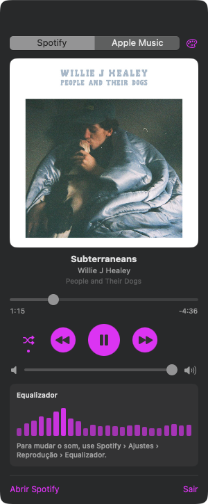
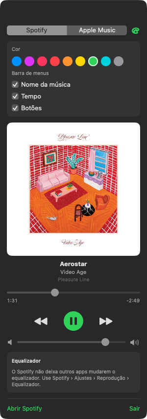

# MenuBarPlayer

A small macOS menu bar app that shows and controls what is playing in Spotify or Apple Music.


<p>
  
  
</p>

## Features

- **Menu bar:** animated equalizer bars, track title, elapsed / total time and
  previous / play-pause / next buttons. Each part can be turned on or off.
- **Panel** (click the title in the menu bar): album artwork, title, artist and album,
  seek bar with times, large play/pause, volume.
- **Colors:** pick the accent color from the palette button at the top of the panel.
- **Equalizer:**
  - Apple Music: turn the equalizer on/off and pick a preset (Rock, Jazz, Bass Booster…).
  - Spotify does not let other apps change its equalizer; the panel points to
    Spotify › Settings › Playback › Equalizer instead.
- Switches automatically to whichever app starts playing.
- No Dock icon; never launches the music app on its own.

Requires macOS 13+ and Swift 5.10+.

## Build and install

```bash
./build.sh
pkill -x MenuBarPlayer; ditto MenuBarPlayer.app /Applications/MenuBarPlayer.app
open /Applications/MenuBarPlayer.app
```

On first use macOS asks for permission to control Spotify / Music
(System Settings › Privacy & Security › Automation).

## Screenshots

The images in `docs/` are taken from the running app:

```bash
.build/release/MenuBarPlayer --preview panel   # also: settings, bar
# prints "WINDOW <id>"; then:
screencapture -x -o -l <id> docs/panel.png
```
