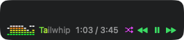
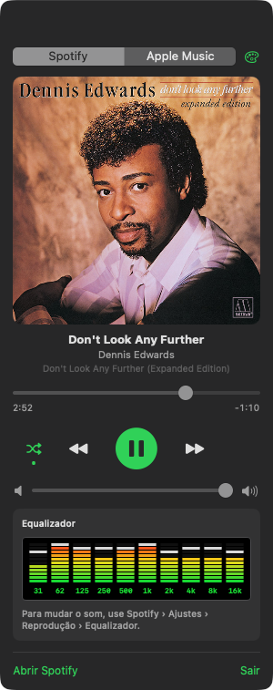

# MenuBarPlayer

A small macOS menu bar app that shows and controls what is playing in Spotify or Apple Music.




<p>
  
  
  
</p>

## Features

- **Menu bar:** live spectrum bars, track title, elapsed / total time and
  shuffle / previous / play-pause / next buttons. Each part can be turned on or off.
  The title doubles as a progress meter: it fills left to right with the equalizer's
  color (accent in Modern, green → yellow → red in Retro) as the song plays.
- **Panel** (click the title in the menu bar): album artwork, title, artist and album,
  seek bar with times, shuffle, playback buttons, volume.
- **Live spectrum:** the bars follow the music. MenuBarPlayer taps only the audio of the
  selected app (Core Audio process tap, macOS 14.2+) and runs an FFT into the 10 standard equalizer bands
  (31 Hz – 16 kHz), each with a falling peak marker.
  macOS asks once for *Screen & System Audio Recording* permission.
- **Appearance** (palette button at the top of the panel): accent color, button color and
  button style (Classic, Filled, Outline, Soft, Minimal), and equalizer style:
  - **Modern:** rounded bars in the accent color.
  - **Retro:** segmented LED bars on black, green → yellow → red, with light peak segments.
- **Equalizer presets:**
  - Apple Music: turn the equalizer on/off and pick a preset (Rock, Jazz, Bass Booster…).
  - Spotify does not let other apps change its equalizer; the panel points to
    Spotify › Settings › Playback › Equalizer instead.
- Switches automatically to whichever app starts playing.
- No Dock icon; never launches the music app on its own.

Requires macOS 13+ and Swift 5.10+.

## Build and install

```bash
./build.sh
pkill -x MenuBarPlayer; ditto MenuBarPlayer.app /Applications/MenuBarPlayer.app
open /Applications/MenuBarPlayer.app
```

On first use macOS asks for permission to control Spotify / Music
(System Settings › Privacy & Security › Automation).

## Screenshots

The images in `docs/` are taken from the running app:

```bash
open -n MenuBarPlayer.app --stdout /tmp/w.txt --args --preview panel   # also: settings, bar
# /tmp/w.txt gets "WINDOW <id>"; then:
screencapture -x -o -l <id> docs/panel.png
```
