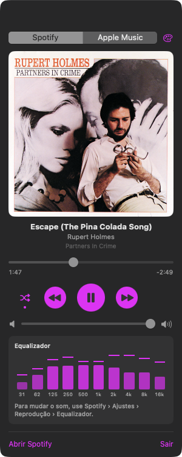
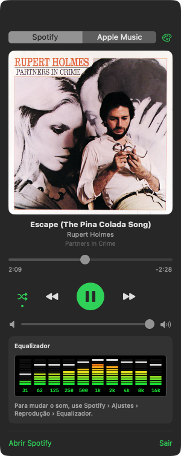
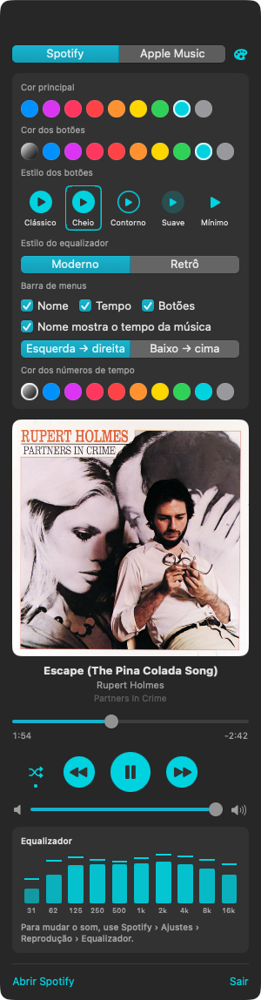

<p align="center">
  
</p>

<h1 align="center">eMusic Player</h1>

<p align="center">
  A small macOS menu bar app that shows and controls what is playing in Spotify,<br>
  with a live equalizer that follows the music.
</p>

<p align="center">
  <a href="https://github.com/elisoares/eMusicPlayer/releases/latest/download/eMusicPlayer.dmg"><b>⬇ Download the latest version (.dmg)</b></a>
  &nbsp;·&nbsp;
  <a href="https://github.com/elisoares/eMusicPlayer/releases">All releases</a>
</p>

<p align="center">
  <br>
  <br>
  <sub>Menu bar: live equalizer, song title that fills up as the song plays, time and controls (Modern and Retro styles)</sub>
</p>

<p align="center">
  
  &nbsp;
  
  &nbsp;
  <br>
  <sub>Panel (click the title in the menu bar): Modern · Retro · Settings</sub>
</p>

## Install

1. Download [eMusicPlayer.dmg](https://github.com/elisoares/eMusicPlayer/releases/latest/download/eMusicPlayer.dmg),
   open it and drag **eMusic Player** to **Applications**.
2. The app is not notarized by Apple, so the first launch is blocked. Open
   **System Settings › Privacy & Security**, scroll down and click **Open Anyway** next to
   eMusic Player. Or run once in Terminal:

   ```bash
   xattr -dr com.apple.quarantine "/Applications/eMusic Player.app"
   ```

3. On first use macOS asks for two permissions:
   - **Automation** for Spotify, to read the current song and control playback.
   - **Screen & System Audio Recording**, so the equalizer can follow the music. Only the
     Spotify audio is analyzed; nothing is recorded or saved.

Requires macOS 13 or newer (the live equalizer needs macOS 14.2). Runs on Apple silicon and Intel.

## Features

- **Menu bar:** live equalizer, song title, elapsed / total time and
  shuffle / previous / play-pause / next buttons. Each part can be turned on or off.
  The title doubles as a progress meter: it fills with the equalizer's color as the song
  plays, left → right or bottom → top. The color of the time numbers can be changed too.
- **Panel:** album artwork, title, artist and album, seek bar with times, shuffle,
  playback buttons, volume and the equalizer.
- **Live equalizer:** the 10 standard bands (31 Hz – 16 kHz) of the music, each with a
  falling peak marker. eMusic Player taps only the audio of Spotify
  (Core Audio process tap) and runs an FFT on it.
- **Appearance** (palette button at the top of the panel): accent color, button color,
  button style (Classic, Filled, Outline, Soft, Minimal) and equalizer style:
  - **Modern:** rounded bars in the accent color.
  - **Retro:** segmented LED bars on black, green → yellow → red, with light peak segments.
- **Sound equalizer:** Spotify does not let other apps change its equalizer; the panel
  points to Spotify › Settings › Playback › Equalizer instead.
- Light on resources: the equalizer runs at 15 fps and only while music plays; paused,
  the app stays near 0% CPU.
- No Dock icon; never launches Spotify on its own.

## Build from source

Requires Xcode command line tools (Swift 5.10+).

```bash
./build.sh                     # builds "eMusic Player.app"
pkill -x eMusicPlayer; ditto "eMusic Player.app" "/Applications/eMusic Player.app"
open "/Applications/eMusic Player.app"
```

```bash
./release.sh                   # universal app + dist/eMusicPlayer.dmg
swift Tools/make-icon.swift    # regenerates the icon
```

The screenshots in `docs/` are taken from the running app:

```bash
open -n "eMusic Player.app" --stdout /tmp/w.txt --args --preview panel   # also: settings, bar
# /tmp/w.txt gets "WINDOW <id>"; then:
screencapture -x -o -l <id> docs/screenshots/panel.png
```
